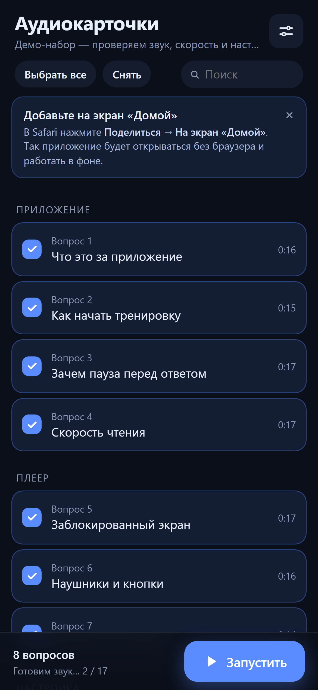
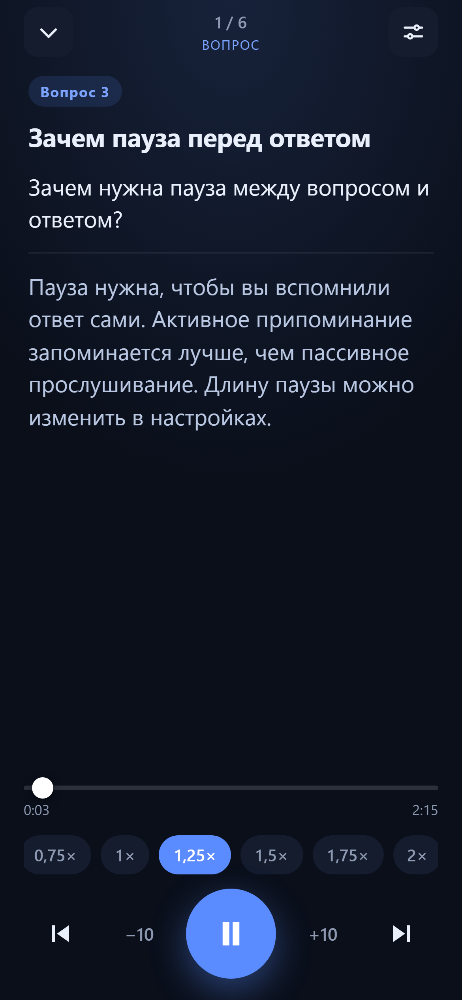

# Аудиокарточки

Тренажёр для подготовки к экзамену: выбираете вопросы, нажимаете «Запустить» — приложение читает вопрос, держит паузу, чтобы вы ответили сами, и читает ответ. Звук идёт в Bluetooth-наушники, продолжает играть при заблокированном экране и работает офлайн.

**Приложение:** https://thereiskalinov.github.io/audio-cards/




## Установка на iPhone

1. Откройте ссылку в **Safari** (именно в Safari, не в Chrome).
2. Кнопка «Поделиться» → **«На экран „Домой“»**.
3. Откройте приложение с иконки — оно запустится без браузера.

После первого запуска все вопросы и озвучка скачиваются в память телефона — в зале можно слушать в авиарежиме.

## Что умеет

- Выбор одного, нескольких или всех вопросов, поиск.
- Скорость чтения 0,75× … 2× (меняется на ходу).
- Режим «вопрос → пауза на подумать (0–20 с) → ответ» или «подряд».
- Пауза между карточками, повтор каждой карточки, перемешивание.
- Блокировка экрана и управление с наушников (Media Session API).
- Офлайн-режим: звук и интерфейс кэшируются.

## Как устроено

- `docs/` — статическое приложение (PWA), публикуется через GitHub Pages.
- `content.src/demo.json` — исходник карточек (`q` — вопрос, `a` — ответ, `section`, `num`, `title`).
- `tools/build_audio.py` — озвучивает карточки нейроголосом (edge-tts) и собирает `docs/content/cards.json`.
- `tools/make_icons.py`, `tools/make_qr.py` — иконки и QR-код.
- `tools/test_ui.mjs` — автотест интерфейса и воспроизведения (puppeteer-core).

## Обновить содержимое

1. Отредактируйте JSON в `content.src/` или добавьте новый файл.
2. Озвучьте и соберите:

```powershell
python tools/build_audio.py content.src/demo.json
```

3. Закоммитьте и запушьте изменения в `docs/`:

```powershell
git add docs && git commit -m "new cards" && git push
```

Приложение подтянет обновление при следующем открытии с интернетом.

## Голоса

По умолчанию `ru-RU-DmitryNeural` (мужской). Альтернативы: `ru-RU-SvetlanaNeural`, `ru-RU-DariyaNeural`.

> Репозиторий публичный: содержимое `docs/` доступно по ссылке GitHub Pages. Сейчас там только демо-набор.
